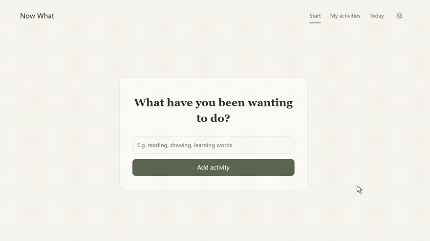
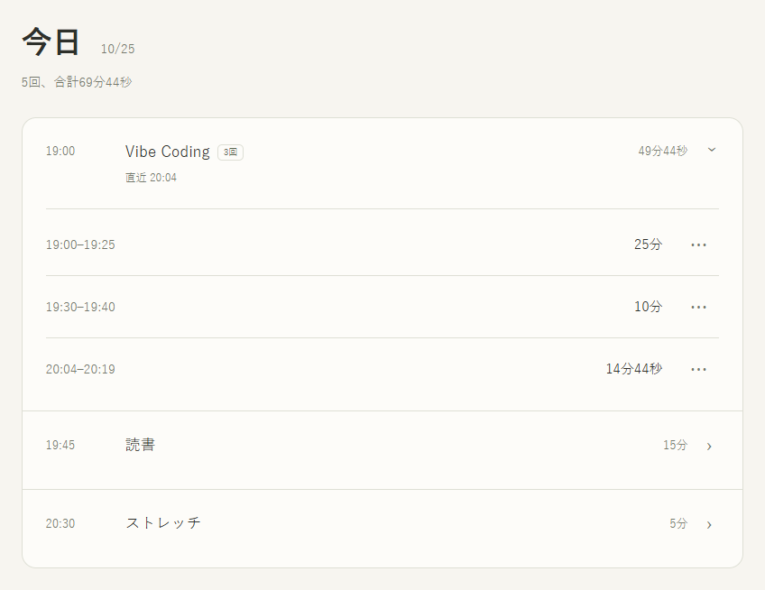
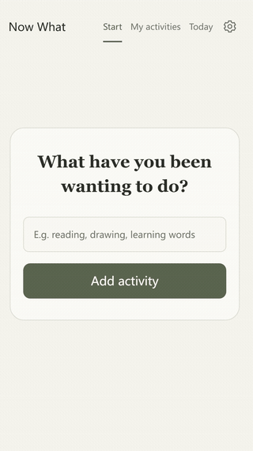

<a href="README.md">English</a> · <a href="README.zh-CN.md">简体中文</a> · <strong>日本語</strong>

<h1 align="center">Now What</h1>

少し時間が空いた？ ずっとやりたかったことをひとつ選んで、今はじめよう。

<a href="https://taouyh.github.io/now-what-to-do/about/?lang=ja">紹介ページ</a> · <a href="https://taouyh.github.io/now-what-to-do/">オンラインで試す</a> · <a href="https://github.com/Taouyh/now-what-to-do/releases">ダウンロード</a> · <a href="#使い方を見る">デモ</a> · <a href="LICENSE">MIT ライセンス</a>

Windows · Android · Web &nbsp; / &nbsp; 無料 · 登録不要 · <a href="LICENSE">MIT</a>

## 使い方

やりたいことはたくさん。でも、時間ができると何からはじめるか迷ってしまう。ここに書き留めておけば、今の状況に合うことをひとつ選んで、すぐにはじめられます。

1. **やりたいことを書く。** 読書、絵、語学。まずは名前だけで大丈夫。
2. **今の状況を選ぶ。** 空いている時間、パソコンや音声の利用、声を出せるか、中断されそうかを選びます。
3. **ひとつ、はじめる。** 提案から開始するか、別のことを選べます。自分で選んでも大丈夫。

活動ごとに時間を決める必要はありません。毎回、今ある時間を選びます。終了すると使った時間が記録され、活動は次回も残ります。

「終了」を押すと実際に使った時間を保存し、ホームに戻ります。今の状況に合う別の活動があれば、そちらを提案します。確認や新規追加は求めず、記録した時間を短い通知でお知らせします。

## 今日を、ひと目で振り返る

**1.2 の新機能：**「今日」では同じ活動の記録をまとめ、回数と実際に使った時間を表示します。活動を開くと、各回の時間帯と所要時間が1行ずつ並びます。正確な時刻や予定・追加・一時停止の時間は **⋯** から確認でき、追加や一時停止が0の場合は表示しません。カードは10秒後に閉じ、詳細を開くと数え直します。元の記録はそのまま残ります。

## 使い方を見る

[Windows のデモ](about/assets/windows-demo.mp4) · [モバイルのデモ](about/assets/mobile-demo.mp4) · [紹介ページで見る](https://taouyh.github.io/now-what-to-do/about/?lang=ja#demo)

どちらも14秒。活動がない状態から開始までを紹介します。英語の画面、オリジナルの穏やかな音楽、音声なし。

モバイル版のデモ — クリックでアニメーションを表示

## ダウンロード

| プラットフォーム | ダウンロード | 必要な環境 |
| --- | --- | --- |
| Windows | [インストーラー (.exe、約2 MiB)](https://github.com/Taouyh/now-what-to-do/releases/download/v1.2.0/Now-What-1.2.0-Windows-x64-Setup.exe) | Windows 10 / 11、64ビット。Microsoft WebView2。 |
| Android | [インストーラー (.apk)](https://github.com/Taouyh/now-what-to-do/releases/download/v1.2.0/Now-What-1.2.0-Android.apk) | Android 7.0以降、最新の WebView。 |
| Web | [ブラウザで開く](https://taouyh.github.io/now-what-to-do/) | インストール不要。 |

インストール版はオフラインで使え、初回は**英語**です。**設定**で英語・中国語・日本語を切り替えられます。Web 版はブラウザの言語に合わせます。選択は保存されますが、自分で書いた活動名やメモは翻訳されません。

Windows では「不明な発行元」と表示される場合があります。Android は実機では未検証です。全バージョンは [Releases](https://github.com/Taouyh/now-what-to-do/releases) にあります。ダウンロードできない場合は Web 版をご利用ください。

**Windows 1.1 は C++ のネイティブウィンドウとシステムの WebView2 を使い、Electron を同梱しません。** 未導入の場合のみ、セットアップが Microsoft のランタイムをダウンロードします。その後はオフラインで使えます。同一端末・同条件での合計プライベートメモリは約 188 → 124 MiB でした。端末とランタイムにより結果は異なります。[実測とビルドの説明](docs/installable-builds.md#windows-memory)をご覧ください。

**Windows 1.0 から更新する場合：**実行中のタイマーを終了し、旧版の設定からバックアップを保存してください。1.2 をインストールしたら設定から復元します。保存場所が異なるため自動移行はされません。旧データは削除しません。[1.0 のインストーラー](https://github.com/Taouyh/now-what-to-do/releases/tag/v1.0.0)も引き続き利用できます。Android は同じパッケージ名と署名を使います。旧版を削除せずに上書きインストールしてください。

**1.1 から 1.2** へは上書きインストールできます。保存場所と形式、Android の署名は変わりません。

## データの保存

- 活動と履歴は、今の端末のアプリやブラウザだけに保存されます。自動同期はしません。データを消去すると、一緒に消えることがあります。
- **設定 → データをバックアップ → エクスポート**からコピーを保存できます。復元すると現在の活動・履歴・設定が置き換わります。実行中のタイマーは含まれません。

## 自分で実行・公開する

**Code → Download ZIP** からダウンロードし、解凍して `index.html` を開くだけです。

GitHub Pages で公開するには、Fork 後に **Settings → Pages** でブランチと **/ (root)** を選びます。元のホームはアプリのままで、紹介ページは `/about/` です。[公開の案内](docs/site-and-readme.md) · [Windows / Android 版のビルド](docs/installable-builds.md)。

## ライセンス

[MIT](LICENSE) © 2026 Taouyh。利用・変更・共有できます。ライセンス表示を残してください。
