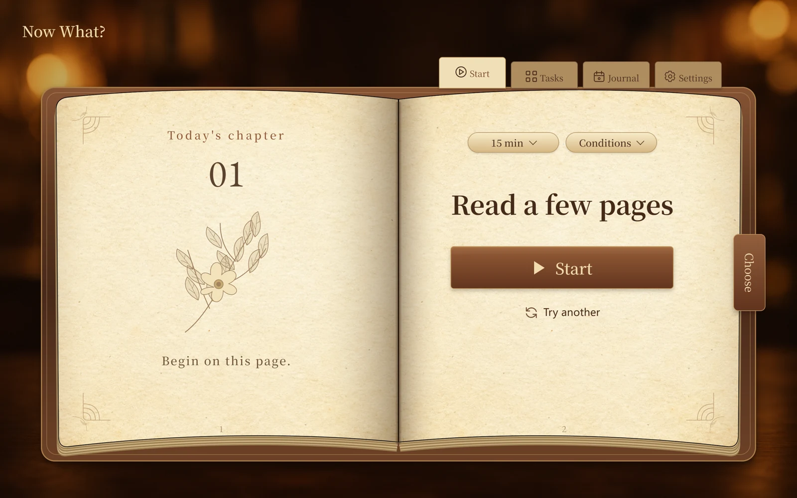

<a href="README.md">English</a> · <a href="README.zh-CN.md">简体中文</a> · <strong>日本語</strong>

<h1 align="center">Now What</h1>
<h3 align="center">少しの時間で、ひとつはじめよう。</h3>

ずっとやりたかったことを置いておく。時間が空いたら、ひとつ選ぶ。

<a href="#features">機能</a> · <a href="#download">ダウンロード</a> · <a href="#start">使い方</a> · <a href="#privacy">プライバシー</a> · <a href="#development">開発</a> · <a href="#license">ライセンス</a>

  
  
  

<a href="https://taouyh.github.io/now-what-to-do/">ブラウザで使う</a> · <a href="https://taouyh.github.io/now-what-to-do/about/">紹介ページ</a>

<a href="https://taouyh.github.io/now-what-to-do/about/#demo">PC版デモ</a> · <a href="https://taouyh.github.io/now-what-to-do/about/#android-demo">Android版デモ</a>

**1.4.1 の更新：**活動のピン留めとドラッグによる並べ替えに対応（各グループ内）。一覧はページ送りで表示し、活動の説明は初期状態で開きます。モバイル表示とボタンも改善しました。
## できること

- **迷ったら、ひとつ。** 読書、絵、語学などを登録。提案から選んだり、別の候補や自分の一覧から選べます。
- **次の一歩が見える。** 「前回の続きから1ページ読む」など、任意の一文をおすすめ画面に表示できます。
- **変えた候補は、今回は出さない。** しっくりこなければ次へ。候補がなくなったら、もう一度見るか自分で選べます。
- **今の状況に合わせる。** パソコンを使える、音を聞ける、声を出せる、中断されるかもしれない。最初はすべて未選択で、その後の選択は保存されます。
- **空いた時間で。** 10・15・20・30・60分、または好きな時間を設定。パソコンでは時間や条件にマウスを重ねると開き、パネルから離すと閉じます。スマホではタップで操作します。
- **戻って、続きを。** 時間が来たら停止し、「続ける」で延長。開き直すと再開待ちになり、長い休止後は前回の時間を別に記録します。
- **今日を振り返る。** 同じ活動の記録をまとめ、回数と合計時間を表示。各回の記録を開いて確認できます。
- **好みに合わせて。** ライト・ダークテーマ、英語・中国語・日本語。Windows・Android・ブラウザに対応。

## ダウンロード

| 環境 | 入手先 | 必要なもの |
| --- | --- | --- |
| Windows | [インストーラー](https://github.com/Taouyh/now-what-to-do/releases/download/v1.4.3/Now-What-1.4.3-Windows-x64-Setup.exe) · 13.3 MiB | Windows 10 / 11、64ビット |
| Android | [APK をダウンロード](https://github.com/Taouyh/now-what-to-do/releases/download/v1.4.3/Now-What-1.4.3-Android-build10.apk) · 11.5 MiB | Android 7.0以降 |
| Web | [ブラウザで開く](https://taouyh.github.io/now-what-to-do/) | インストール不要 |

無料、登録不要。インストール版はオフラインで使え、初回は英語です。**設定**で言語を変更できます。Web版はブラウザの言語に合わせて起動します。

**更新について：**旧版の未終了タイマーは、保存済みの進み具合がなければ実際に使った時間を確認します。既存の終了済み記録は保持されます。

インストールと更新について

- Windows はシステムの WebView2 を使います。未導入の場合のみセットアップ中にダウンロードします。インストーラーは未署名のため、「不明な発行元」と表示される場合があります。
- Android は新しい WebView が必要です。パッケージと署名は確認済みですが、実機での動作は未検証です。
- 1.1–1.4 からは上書きで更新できます。データの保存場所は同じです。Android は先にアンインストールしないでください。
- **Windows 1.0** からは、旧版でバックアップを書き出し、新版の設定で復元してください。自動移行はありません。進行中のタイマーはバックアップに含まれません。
- [すべてのリリース](https://github.com/Taouyh/now-what-to-do/releases) · [詳しいインストール・更新手順](docs/installable-builds.md)

## 使い方

1. **やりたいことを書く。** 「読書」など、名前だけで大丈夫です。
2. **空いている時間を選ぶ。** 必要なら今の条件も調整します。
3. **開始を押す。** 終わったら終了を押すと、使った時間が保存されます。

[PC版デモ](https://taouyh.github.io/now-what-to-do/about/#demo) · [Android版デモ](https://taouyh.github.io/now-what-to-do/about/#android-demo) · [1.4.1 の更新内容](docs/releases/v1.4.1.md)

## データとプライバシー

活動・設定・記録は今の端末に保存され、自動同期されません。端末を変える前に、**設定 → データのバックアップ → エクスポート**で控えを保存してください。

アプリやブラウザのデータを消すと記録も失われる場合があります。復元すると現在のデータが置き換わり、進行中のタイマーは含まれません。

## 開発・貢献

1.4 はブック版です。GitHub Pages は `master` からアプリと3言語の紹介ページをビルドします。Node.js 24 で `npm ci` と `npm run web` を実行してください。

[Windows / Android のビルド](docs/installable-builds.md) · [紹介ページの公開](docs/site-and-readme.md)

## ライセンス

[MIT](LICENSE) © 2026 Taouyh。使用・変更・共有できます。ライセンス表記を残してください。

[PC版デモ](https://taouyh.github.io/now-what-to-do/about/#demo) · [Android版デモ](https://taouyh.github.io/now-what-to-do/about/#android-demo) · [編集可能な Figma 紹介ページ](https://www.figma.com/design/EUoXZR1hDJUUPVAtrDxpE5?node-id=367-4469)

どちらも59秒。英語ナレーション、英語・中国語字幕、穏やかな音楽とクリック音付きです。
