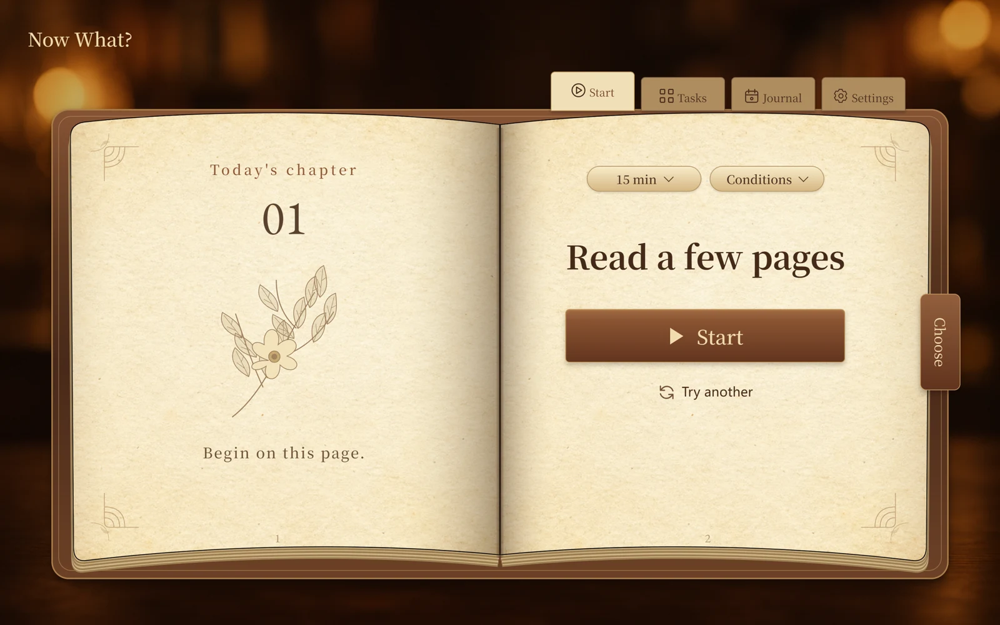

<strong>English</strong> · <a href="README.zh-CN.md">简体中文</a> · <a href="README.ja.md">日本語</a>

<h1 align="center">Now What</h1>
<h3 align="center">A little time. A page of your own.</h3>

Keep the things you want to do. Choose one that fits right now.

<a href="#features">Features</a> · <a href="#download">Download</a> · <a href="#start">Quick start</a> · <a href="#privacy">Privacy</a> · <a href="#development">Development</a> · <a href="#license">License</a>

  
  
  

<a href="https://taouyh.github.io/now-what-to-do/">Try it online</a> · <a href="https://taouyh.github.io/now-what-to-do/about/">Website</a>

**New in 1.4.1:** pin favorite activities and drag to reorder within pinned or unpinned groups. Task pagination fits the available space, descriptions open by default, and mobile layouts and shared controls are refined.
## Features

**New in 1.4: a book for your time.** A warm paper interface, bookmark navigation, a two-page activity library and a journal of your sessions.

- **Pick one and begin.** Add reading, drawing or anything else you want to do. Accept a suggestion, try another or choose for yourself.
- **Know the next step.** Add an optional line such as “Open where I left off and read one page.” It appears right on the recommendation.
- **Swap without repeats.** Activities you skip stay out of this round. Look again or choose for yourself when none feels right.
- **Fit the moment.** Say whether you can use a computer, listen, speak or might be interrupted. All conditions start unchecked; your choices are remembered.
- **Use the time you have.** Choose 10, 15, 20, 30, 60 minutes or your own duration. On desktop, hover over time or conditions to open the menu; move away from the panel to close it. On mobile, tap.
- **Pick up where you stopped.** Time stops at the end of a round until you choose Continue. Reopening waits for you to resume; a long break keeps the previous time as a separate session.
- **See your day.** Review your sessions in the book-style Journal. Open an activity to see its recorded sessions.
- **Make it yours.** Light and dark themes. English, Chinese and Japanese. Windows, Android and web.

## Download

| Platform | Get it | Requirements |
| --- | --- | --- |
| Windows | [Download installer](https://github.com/Taouyh/now-what-to-do/releases/download/v1.4.1/Now-What-1.4.1-Windows-x64-Setup.exe) · 18.6 MiB | Windows 10 / 11, 64-bit |
| Android | [Download APK](https://github.com/Taouyh/now-what-to-do/releases/download/v1.4.1/Now-What-1.4.1-Android.apk) · 18.2 MiB | Android 7.0+ |
| Web | [Open in browser](https://taouyh.github.io/now-what-to-do/) | Nothing to install |

Free. No account. Installed apps work offline and start in English; change the language in **Settings**. The web app starts with your browser language.

**Updating:** an unfinished older timer may ask you to confirm the time you actually spent. Your existing completed records stay intact.

Installation and upgrade notes

- Windows uses the system WebView2 runtime. Setup downloads it if missing, so the first installation may need internet. The installer is unsigned and may show an unknown-publisher notice.
- Android needs an up-to-date WebView. Package contents and signing passed independent checks. The owner confirmed the candidate installers before release; automated checks did not run on an Android device.
- Update from 1.1–1.4 by installing over the existing app. The data location stays the same. Do not uninstall Android first.
- From **Windows 1.0**, export a backup in the old app, then restore it in the new app's Settings. Migration is manual. Backups do not include a running timer.
- [All releases](https://github.com/Taouyh/now-what-to-do/releases) · [Detailed installation and upgrade guide](docs/installable-builds.md)

## Quick start

1. **Add something you want to do.** A name, such as “Read a book,” is enough.
2. **Choose the time you have.** Adjust your current conditions if needed.
3. **Press Start.** When you're done, press End to save your time.

[Watch the 86-second introduction](https://taouyh.github.io/now-what-to-do/about/#demo) · [What's new in 1.4.1](docs/releases/v1.4.1.md)

## Privacy

Activities, settings and history stay on this device. There is no automatic sync. Save a copy in **Settings → Back up data → Export** before switching devices.

Clearing app or browser data can erase your records. Restoring a backup replaces current data and does not include a running timer.

## Development & contribution

Version 1.4 is the book edition. GitHub Pages builds `master` and publishes the app and trilingual introduction page together. With Node.js 24, run `npm ci`, then `npm run web` and open the local URL printed in the terminal. Use `npm run dev` for live development, `npm test` and `npm run test:e2e` for checks. Do not open the source HTML directly. See the [implementation and verification record](docs/development/book-c-2026-11-05/IMPLEMENTATION.md). Suggestions in [Issues](https://github.com/Taouyh/now-what-to-do/issues) and Pull Requests are welcome.

[Build Windows / Android](docs/installable-builds.md) · [Publish the website](docs/site-and-readme.md)

## License

[MIT](LICENSE) © 2026 Taouyh. Use, change and share it; keep the license notice.

[86-second English demo](https://taouyh.github.io/now-what-to-do/about/#demo) · [Editable Figma poster](https://www.figma.com/design/EUoXZR1hDJUUPVAtrDxpE5?node-id=367-4469)

The demo uses soft music and mouse clicks, with no voiceover.

