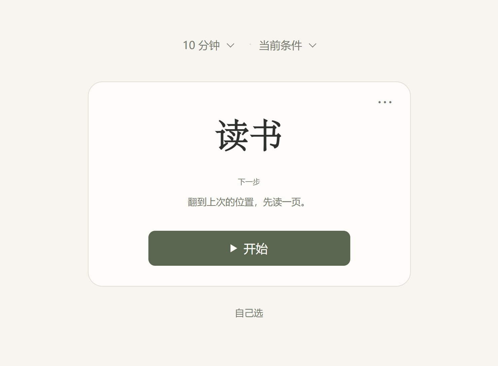
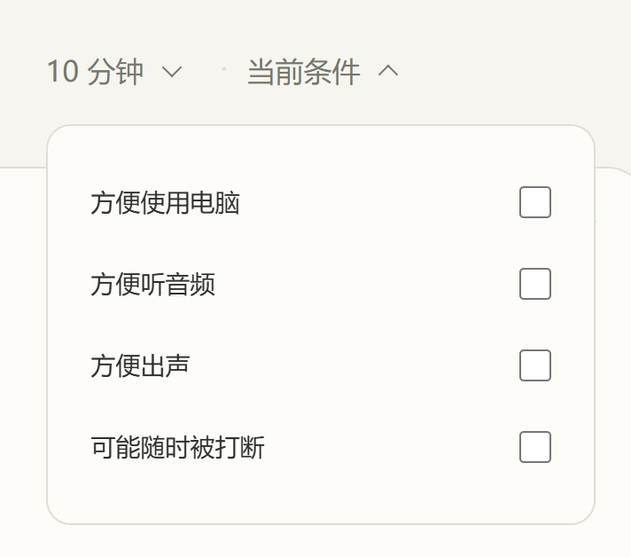
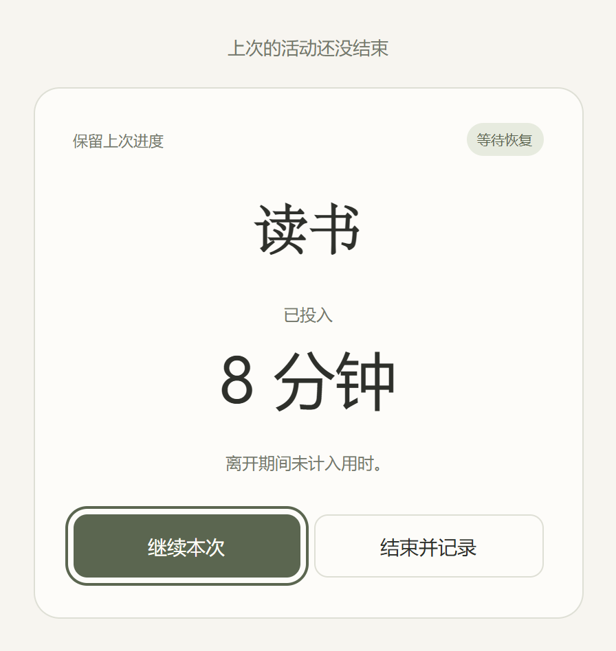
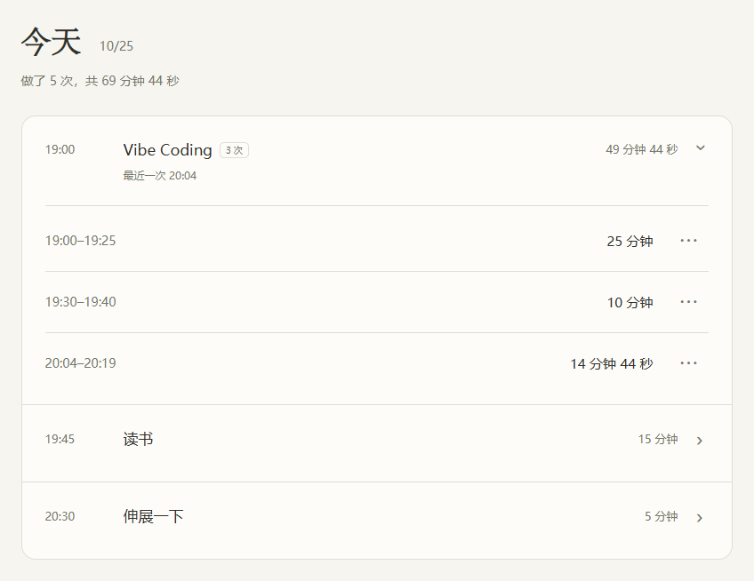

<a href="README.md">English</a> · <strong>简体中文</strong> · <a href="README.ja.md">日本語</a>

<h1 align="center">Now What</h1>
<h3 align="center">有点空闲，现在就开始。</h3>

把一直想做的事放在这里，有空时选一件，做一点。

<a href="#features">功能</a> · <a href="#download">下载安装</a> · <a href="#start">怎么用</a> · <a href="#privacy">数据与隐私</a> · <a href="#development">开发</a> · <a href="#license">许可</a>

  
  
  

<a href="https://taouyh.github.io/now-what-to-do/">在线体验</a> · <a href="https://taouyh.github.io/now-what-to-do/about/?lang=zh-CN">宣传页</a>

## 有哪些功能

- **少纠结，先做一件。** 写下读书、画画、学语言等想做的事；接受推荐、换一件，或者自己选。
- **看清下一小步。** 可以选填「翻到上次的位置，先读一页」这样一句话，直接显示在推荐卡片上。
- **换过的，本轮不再推。** 不想做就换一件；都没感觉时，可以重新看看，或者自己选。
- **按当下条件选。** 能用电脑、听音频、出声，或者可能被打断，都可以告诉它。默认全部不勾选，选过会记住。
- **有几分钟，就做几分钟。** 每次选 5、10、15、30、60 分钟或自定义。电脑上鼠标移到时间或条件入口就能展开，移出弹框自动收起；手机轻点操作。
- **回来接着做。** 到点停止，点击继续才追加。关闭后保留进度，重开先等你确认；暂停很久时，上次用时单独保留。
- **一眼回看今天。** 同一活动的多次记录放在一起，次数和总用时一目了然。展开看每次记录，10 秒后自动收起。
- **按自己的习惯用。** 浅色、深色，中文、英语、日语；Windows、安卓、网页都能用。

## 下载安装

| 平台 | 入口 | 使用要求 |
| --- | --- | --- |
| Windows | [下载安装包](https://github.com/Taouyh/now-what-to-do/releases/download/v1.3.0/Now-What-1.3.0-Windows-x64-Setup.exe) · 约 2 MiB | Windows 10 / 11，64 位 |
| 安卓 | [下载 APK](https://github.com/Taouyh/now-what-to-do/releases/download/v1.3.0/Now-What-1.3.0-Android.apk) | Android 7.0 及以上 |
| 网页 | [直接打开](https://taouyh.github.io/now-what-to-do/) | 不用安装 |

免费，不用注册。安装版可离线使用，第一次打开为英语，在**设置**里可切换中文；网页版默认跟随浏览器语言。

**更新到 1.3：**旧版未结束的计时如果缺少保存进度，会请你确认实际用时，已有完成记录保持原样。

安装和升级时需要知道的事

- Windows 依赖系统 WebView2，缺少时安装器会下载，首次安装需要联网。安装包暂未签名，可能提示「未知发布者」。
- 安卓需要较新的 WebView；已检查包内容和签名，尚未在真机上验证运行。
- 从 1.1 / 1.2 升级可直接覆盖安装，数据位置不变。安卓不要先卸载。
- 从 **Windows 1.0** 升级：先在旧版导出备份，安装新版后在设置中导入；不会自动迁移。运行中的计时不包含在备份中。
- [全部版本](https://github.com/Taouyh/now-what-to-do/releases) · [详细安装与升级说明](docs/installable-builds.md)

## 怎么用

1. **写下想做的事。** 一个名字就够，比如「读书」。
2. **看看现在有多少时间。** 需要时再调整当前条件。
3. **点「开始」。** 做完点「结束」，这次用时会自动记下来。

看看条件选择、计时恢复和今天的记录

[观看 14 秒入门演示](https://taouyh.github.io/now-what-to-do/about/?lang=zh-CN#demo) · [1.3.0 更新说明](docs/releases/v1.3.0.md)

## 数据与隐私

活动、设置和记录保存在当前设备，不会自动同步。换设备前，在**设置 → 备份数据 → 导出**里留一份备份。

清理应用或浏览器数据可能会删掉记录。导入备份会替换现有数据，不包含正在进行的计时。

## 开发与贡献

下载源码后打开 `index.html` 就能运行。欢迎通过 [Issue](https://github.com/Taouyh/now-what-to-do/issues) 提建议，或提交 Pull Request。

[制作 Windows / 安卓安装包](docs/installable-builds.md) · [发布宣传页](docs/site-and-readme.md)

## 开源许可

[MIT](LICENSE) © 2026 Taouyh。可以使用、修改和分享，请保留许可声明。
