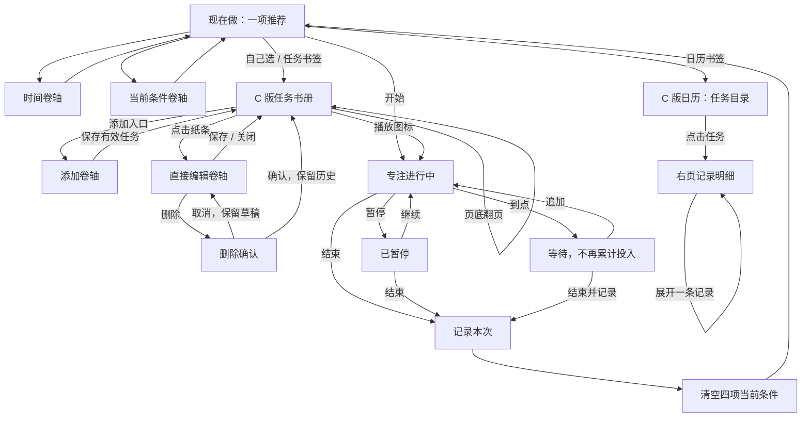

# C 版任务与日历 + B 版其余页面 · 页面与交互契约

2026-11-04。配套 [当前 PRD](PRD.md)。任务列表及其卷轴、日历采用 C 版；首页、时间与条件、专注、设置采用 B 版。本文描述目标行为；原型尚未覆盖的部分见 PRD 第 11 节，不用连线存在替代真实运行验收。

## 主流程

上图省略了全局书签与返回专注连接以保持可读；这些入口同样属于必需流程。已有专注时，任何播放入口均返回原会话，不新建第二个计时。

## 点击、状态与数据

| 当前页面/状态 | 用户动作 | 页面结果 | 数据规则 |
| --- | --- | --- | --- |
| 任意书页 | 点击书签 | 进入目标页面，单一书签高亮 | 不自动结束专注；退出表单不提交草稿 |
| 首次进入 / 重启原型 | 打开现在做与条件卷轴 | 四项条件全部未选 | 默认值为 false；不在同一轮每次返回首页时重置 |
| 现在做 | 时间入口 | 展开时间卷轴 | 读取本次时长 |
| 时间卷轴 | 有效预设/自定义确认 | 写回并收起 | 非空无效自定义保留输入、提示错误；空输入退出或确认恢复 10 分钟（2026-11-06） |
| 条件卷轴 | 点击一行 | 切换该项勾选 | 四项独立，不互相替代 |
| 条件卷轴 | 确定、叉号或遮罩关闭 | 收起回当前页 | 同一轮保留选择；不是编辑任务的草稿规则 |
| 现在做 | 换一件 | 下一项或本轮耗尽提示 | 不重复本轮已跳过项，不永久更改偏好 |
| 无结果 | 调整条件 | 打开条件选择 | 不擅自把四项全部设为可用 |
| 本轮耗尽 | 重新看看 | 重建本轮候选 | 清除本轮跳过，不删任务 |
| 任务书册 | 悬停/移出纸条 | 变色/恢复 | 不导航、不保存、不更改右页 |
| 任务书册 | 点击纸条名称或空白 | 右页直接展开编辑 | 从该任务已保存值建立草稿 |
| 任务书册 | 点击播放 | 进入/返回专注 | 与编辑命中区域独立 |
| 任务书册 | 上一页/下一页 | 翻一组双页 | 每张 5 项；首末边界禁用；不滚动整书 |
| 任务书册 | ＋ 添加任务 | 打开空白添加卷轴 | 名称、说明为空，要求全未选 |
| 添加卷轴 | 点击添加，名称为空 | 留在卷轴，显示错误 | 不创建任务，保留说明与条件草稿 |
| 添加卷轴 | 点击添加，名称有效 | 收起并定位新任务所在页 | 保存后清空添加草稿 |
| 编辑卷轴 | 修改名称/说明/要求 | 原位修改字段 | 保存前任务与进行中快照不变 |
| 编辑卷轴 | 保存，无变化 | 收起 | 不写数据、不显示保存提示 |
| 编辑卷轴 | 保存，有变化且有效 | 收起回原页 | 写回对应任务，不改历史与专注快照 |
| 添加/编辑卷轴 | 叉号、取消或切换页面 | 关闭/离开 | 丢弃未保存内容；下次读取保存值 |
| 编辑卷轴 | 删除 | 显示对象与删除范围 | 尚不删除 |
| 删除确认 | 取消 | 返回编辑 | 保留进入确认前草稿 |
| 删除确认 | 确认删除 | 更新任务书册 | 保留历史/专注快照，重新分页并修正页码 |
| 专注中 | 展开/收起说明 | 仅改变说明区域 | 不影响时钟；没有说明不出现空入口 |
| 专注中 | 暂停/继续 | 暂停/运行 | 累计投入连续，暂停不计入 |
| 专注中 | 去任务/日历/设置 | 展示目标页及返回专注入口 | 会话及说明展开状态保留 |
| 到点 | 继续 | 追加后恢复 | 原计划保留；等待不算投入 |
| 运行/暂停/到点 | 结束/结束并记录 | 记录后回新推荐 | 成功记录后清空四项当前条件，再推荐；时间保留 |
| 计时恢复 | 继续/结束 | 经确认恢复或记录 | 不把无法确认的离开时间视为投入 |
| 计时恢复 | 放弃本次 | 直接回首页，显示约 30 秒提示 | 不写记录，不显示正常结束续做反馈 |
| 日历目录 | 点击任务分组 | 右页显示该任务第一组记录 | 只读，最多展开一条 |
| 日历目录 | 左页翻页 | 更换目录，右页回提示态 | 不改变汇总数据 |
| 日历明细 | 右页翻页 | 更换当前任务记录页 | 不翻动左页目录 |
| 日历明细 | 点击记录行 | 展开计划/暂停/追加，收起其他条 | 不编辑历史实际用时 |
| 设置 | 选择语言/外观 | 更新偏好 | 返回设置保持选择；全局覆盖仍待补齐 |
| 设置 | 导入备份 | 替换确认 | 取消无变化，确认后才替换；失败不伪报成功 |
| 设置 | 导出备份 | 由应用交给文件系统处理 | 原型不产生真实文件 |
| 正常结束反馈 | 无操作 | 保留在 B 首页 | 不自动改写活动说明、不强制输入 |
| 正常结束反馈 | 记下次起点 · 刚完成的活动名称 | 展开说明草稿，标题为“活动名称：下次从哪继续？” | 读取刚结束任务的说明，只写回该任务；2026-11-06 反馈澄清对象 |
| 续做草稿 | 保存 / 取消 | 隐藏反馈 | 保存只更新原任务说明；取消不提交；原任务已删除时不误写其他任务 |
| 正常结束反馈 | 开始下一次 / 关闭 | 隐藏反馈 | 不自动提交尚未保存的说明 |

## 页面溢出与状态边界

| 场景 | 目标处理 |
| --- | --- |
| 0 项任务 | 空书页与添加入口，不出现可用的翻页按钮 |
| 1–10 项任务 | 一组双页，最多每页 5 项；不足留白 |
| 第 11 项及以后 | 增加双页组，每组最多 10 项，序号连续 |
| 末组最后一项删除 | 回到前一有效组；总页数同步更新 |
| 日历超过 5 个任务组 | 左页增加目录页，汇总不按当前页局部计算 |
| 同任务超过 4 次记录 | 右页增加明细页，不撑高外框 |
| 长名称 | 不能压住播放图标；需在实际字号下验证换行或截断及完整名称查看，当前未批准具体字符上限 |
| 长说明 | 在阅读/编辑区域内处理内容溢出，不让整书超出窗口；不静默截断保存内容 |
| 小窗口/系统放大 | 完整书本与可读性同时验收；如不能满足需补适配稿，不把缩放链接当实现结果 |
| 删除或编辑正在专注的任务 | 当前会话继续使用快照；结束记录保持原会话归属 |

## 原型评审顺序

1. 从 C 任务入口进入，翻到第二组再返回，确认页码、边界及整书尺寸。
2. 悬停纸条，再点击名称；确认右侧卷轴直接可编辑；播放不能同时触发编辑。
3. 演示空名称、说明清空、关闭不保存、有效保存、无变化保存及删除取消。
4. 添加任务并定位新增页；检查删除后分页边界。固定样例不能替代任意数据量验证。
5. 开始 → 暂停 → 去任务 → 返回专注 → 到点追加 → 结束；检查快照和实际投入。
6. 结束前勾选条件，结束后重新打开条件卷轴；应全未选，时间仍保留。
7. 从书签进入 C 日历，分别翻动左页目录和右页明细，再展开记录；检查统计不变、历史只读及分页独立。
8. 从设置、首页和结束页进入任务或日历，均应进入对应 C 版。动作连接已检查，仍需浏览器实点。
9. 从恢复预设入口尝试继续、结束和直接放弃；检查放弃不写记录、提示约 30 秒。真实刷新恢复由应用另行验收。
10. 正常结束后无操作等待，反馈仍保留；展开并保存 / 清空 / 取消说明，再开始下一次；确认说明属于刚结束的任务。

浏览器实点、任意输入、真实倒计时/备份和参与者测试尚未完成。既有动作图通过项只证明对应原型规则，不等于以上评审步骤已全部通过。
